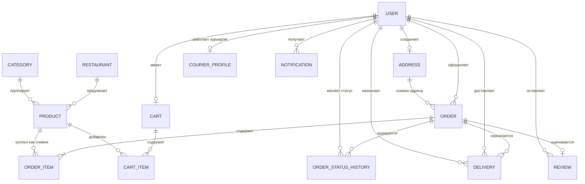

# ER-диаграмма системы «Везём»

`OrderItem.unit_price` и `OrderItem.product_name` сохраняют данные на момент покупки. `Order.address_snapshot` хранит адрес отдельно от редактируемого адреса клиента. Один сохранённый адрес обеспечен связью OneToOne. Переназначения остаются в `Delivery`; актуальное назначение помечено `is_current`.
